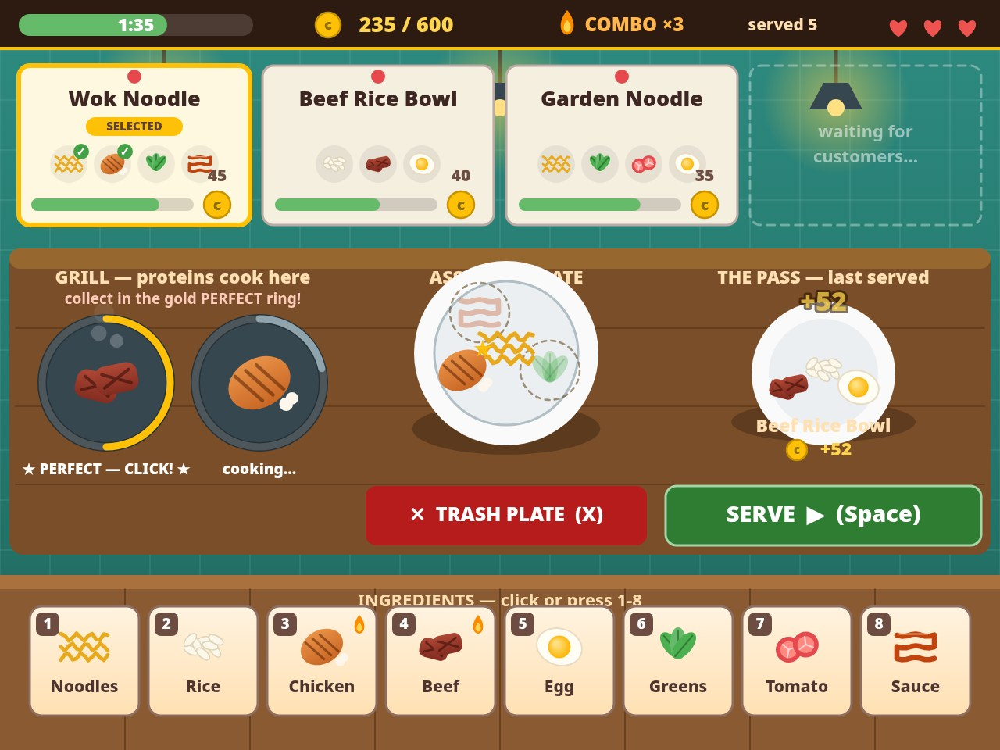
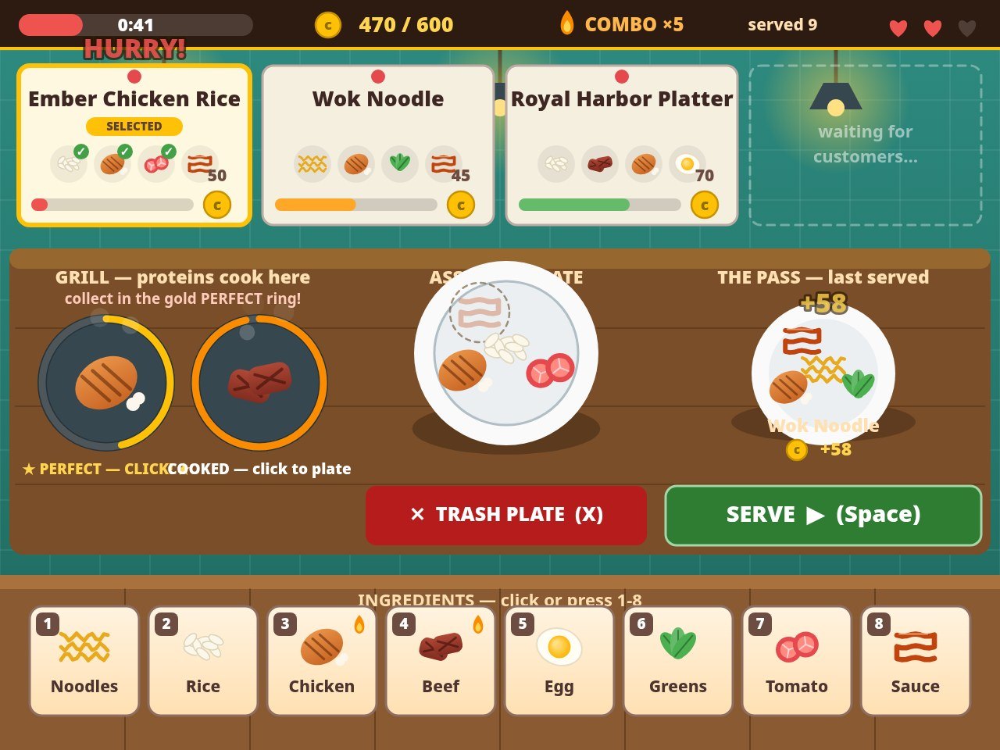
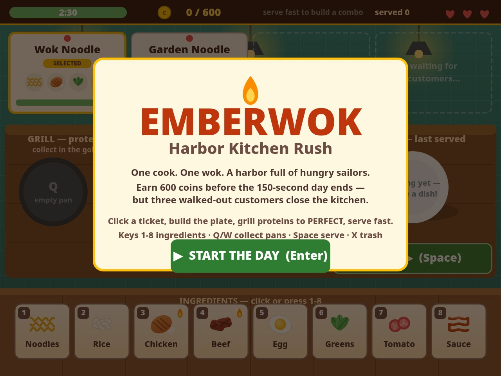
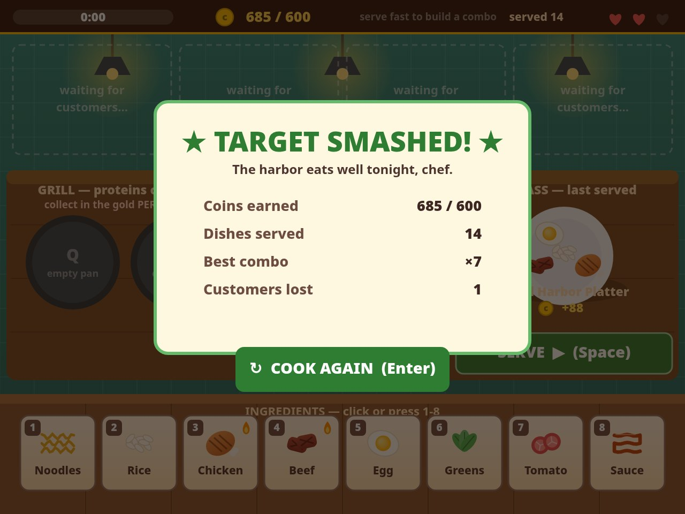

# Emberwok: Harbor Kitchen Rush

One cook, one wok, and a harbor full of hungry sailors. **Emberwok: Harbor Kitchen Rush** is a fast, single-screen canvas cooking game: take the tickets, build each dish on the assembly plate, grill the proteins to their golden PERFECT moment, and serve fast enough to earn **600 coins in a 150-second day** — before three walked-out customers close your kitchen for good.

## How to play

- **Click a ticket** (top row) to select the order you are cooking. Its ingredient icons show green checks as your plate fills up, and the bar underneath is the customer's patience — green, yellow, then red. A full bar means a bigger tip.
- **Click ingredients** (bottom counter) to build the plate. Fresh ingredients go straight on; **chicken and beef detour through the grill** — click one to start a pan, watch the ring, and click the pan to collect. Collect inside the gold **PERFECT** window for bonus coins; leave it too long and it burns.
- **SERVE** once the plate matches the selected recipe exactly. Serving quickly, again and again, builds a **combo** worth extra coins. Wrong plate? **TRASH** it and start over.
- Orders that run out of patience walk out and cost a **heart**. Lose all three hearts, or finish the day under 600 coins, and the kitchen closes.

### Controls

| Action | Mouse | Keyboard |
| --- | --- | --- |
| Add ingredient | Click an ingredient card | `1`–`8` |
| Collect grill pan | Click the pan | `Q` / `W` |
| Serve the selected ticket | SERVE button | `Space` |
| Trash the plate | TRASH PLATE button | `X` |
| Select a ticket | Click the ticket | — |
| Start / restart the day | START button | `Enter` (or `R` to restart mid-day) |

Difficulty ramps through the day: tickets arrive faster and patience runs thinner the closer you get to closing time.

## Run it locally

The game is plain ES modules with no build step and no dependencies. Serve the `game/` folder with any static file server, for example:

```sh
npx serve game
# or
python3 -m http.server --directory game 8000
```

Then open the printed URL in a browser. Optional URL parameters: `?seed=N` changes the day's order stream, and `?shot=play&seed=1` (also `start`, `rush`, `end`) stages a frozen scene — those are the views used for the screenshots below.

## Screenshots









## The hand-in program

`main.ts` (Node 22, standard library only) copies `game/` and `screenshots/` into `MAKEFUN_OUTPUT_DIR` (default `/output`) and writes a `dossier.json` there using the vendored `buildDossier` from `vendor/makefun-game.ts`:

```sh
MAKEFUN_OUTPUT_DIR=/output node main.ts
```

## Bounty

Entered in the make.fun bounty: [Make the best cooking game](https://make.fun/bounty/best-cooking-game-20261125-0137)

## License

MIT — see [LICENSE](LICENSE).
